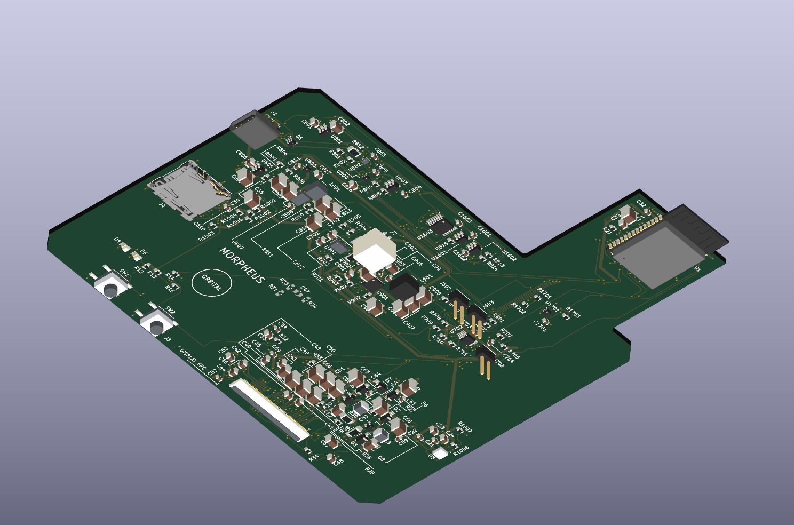
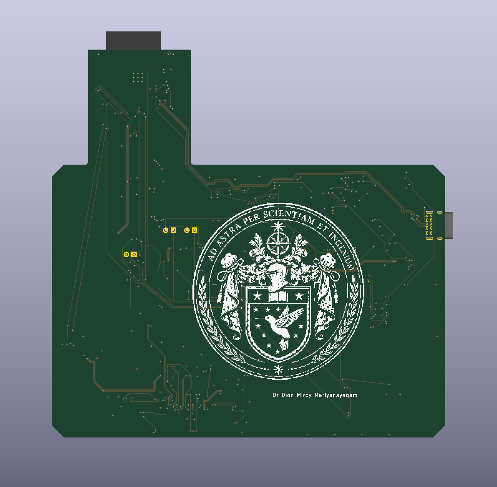

# Morpheus ORBITAL

**A six-layer KiCad prototype for a portable 7.3-inch colour e-paper device.**

Morpheus ORBITAL connects an Espressif **ESP32-S3-WROOM-1-N16R8** to a Good Display **GDEP073E01** colour e-paper panel. It adds USB-C, microSD, a Bosch **BME690** environmental sensor, and a single-cell battery power path. The board keeps the USB-C port, card slot and buttons along the edges and reserves space for the display flex and the module antenna.

[Download the 18-sheet schematic PDF](docs/Morpheus-Schematic.pdf) · [Open in KiCad](#open-in-kicad) · [Find a component](#component-index) · [Download BOM CSV](Morpheus-BOM.csv)

## Hardware at a glance

| Function | Main components |
| --- | --- |
| Compute and wireless | Espressif **ESP32-S3-WROOM-1-N16R8** |
| Display | Good Display **GDEP073E01** 7.3-inch colour e-paper panel and Hirose **FH34SRJ-50S-0.5SH(50)** 50-pin display connector |
| Environmental sensing | Bosch Sensortec **BME690** gas, humidity, pressure and temperature sensor |
| USB-C and protection | GCT **USB4085-GF-A**, onsemi **FUSB303BTMX** Type-C controller, and TI **TPD4E1U06DCKR** ESD protection |
| Storage | Hirose **DM3AT-SF-PEJM5** microSD socket |
| Battery and regulation | TI **BQ25616RTWR** charger, **BQ27441DRZR-G1A** fuel gauge, and **TPS63020DSJR** buck-boost converter |
| Temperature monitoring and controls | TI **ADS1115IDGSR** ADC, external thermistor headers, and **K2-1102SP-A4SC-04** boot and refresh switches |

## Open in KiCad

1. Install [KiCad 10](https://www.kicad.org/download/), including its standard libraries. The project was reviewed with KiCad **10.0.4**. Install the standard KiCad 3D model library for the complete assembly view.
2. Clone the repository below, or use [Download ZIP](https://github.com/DionCroft/morpheus-orbital/archive/refs/heads/main.zip) and extract the entire archive. The project uses relative library and model paths.

       git clone https://github.com/DionCroft/morpheus-orbital.git

3. From KiCad's project manager, open [circuit_design/Morpheus/Morpheus.kicad_pro](circuit_design/Morpheus/Morpheus.kicad_pro). Open **Schematic Editor** or **PCB Editor** from the project.
4. In PCB Editor, choose **View > 3D Viewer** to inspect the populated board. The display panel, battery, and external probes are separate from the PCB assembly.

## Rear 3D view

  

## Component index

Every distinct manufacturer part number in the [reference BOM](Morpheus-BOM.csv) is listed below. The **61 part numbers** cover **169 schematic references**, including the off-board display and four DNP (do not populate) positions. The routed PCB has 164 fitted components. NT901 is the copper net tie.

### Processing, power and semiconductors

| Exact part number | Component or value | Manufacturer | References |
| --- | --- | --- | --- |
| `ADS1115IDGSR` | ADS1115 16-bit ADC | Texas Instruments | U702 |
| `BME690` | Gas, humidity, pressure and temperature sensor | Bosch Sensortec | U3 |
| `BQ25616RTWR` | BQ25616 single-cell battery charger with power path | Texas Instruments | U901 |
| `BQ27441DRZR-G1A` | BQ27441-G1A battery fuel gauge | Texas Instruments | U701 |
| `BZT52C27` | 27 V Zener diode | Jiangsu Changjing Electronics Technology | D3 |
| `ESP32-S3-WROOM-1-N16R8` | ESP32-S3 Wi-Fi and Bluetooth LE MCU module | Espressif Systems | U1 |
| `FUSB303BTMX` | FUSB303B USB Type-C port controller | onsemi | U802 |
| `KT-0805G` | Green indicator LED | Hubei KENTO Electronics | D4, D5 |
| `MBR0530T1G` | Schottky rectifier | onsemi | D2, D6, D7, D8 |
| `SI2301CDS` | P-channel MOSFET | TECH PUBLIC | Q9 |
| `SN74HCS08PWR` | Quad Schmitt-trigger AND gate | Texas Instruments | U1603 |
| `SN74LVC1G14DBVR` | Single Schmitt-trigger inverter | Texas Instruments | U803, U1601, U1602 |
| `Si1308EDL-T1-GE3` | N-channel MOSFET | Vishay | Q8 |
| `TPD4E1U06DCKR` | TPD4E1U06 four-channel ESD protection | Texas Instruments | D1 |
| `TPS2553DBVR` | TPS2553 current-limited power switch | Texas Instruments | U805 |
| `TPS389001DSET` | TPS3890 adjustable voltage supervisor | Texas Instruments | U1701 |
| `TPS389030DSET` | TPS3890 fixed-threshold voltage supervisor | Texas Instruments | U804, U806 |
| `TPS63020DSJR` | TPS63020 buck-boost converter | Texas Instruments | U807 |
| `TPS70933DBVR` | TPS70933 3.3 V LDO regulator | Texas Instruments | U801 |

### Display, connectors and switches

| Exact part number | Component or value | Manufacturer | References |
| --- | --- | --- | --- |
| `2.0-2P WT` | Two-position 2.0 mm battery connector | SHOU HAN | J2 |
| `DM3AT-SF-PEJM5` | microSD card socket | Hirose Electric | J4 |
| `FH34SRJ-50S-0.5SH(50)` | 50-position 0.5 mm display FPC connector | Hirose | J3 |
| `GDEP073E01` | 7.3-inch colour e-paper panel | Good Display | U5 (off-board) |
| `K2-1102SP-A4SC-04` | Boot and refresh tactile switch | Korean Hroparts Electronics | SW1, SW2 |
| `M20-9990246` | 2.54 mm header for temperature sense or charge disable | Harwin | J602, J603, J702 |
| `USB4085-GF-A` | USB-C receptacle | GCT | J1 |

### Capacitors and inductors

| Exact part number | Component or value | Manufacturer | References |
| --- | --- | --- | --- |
| `CL10B104KB8NNNC` | 100nF ceramic capacitor | Samsung Electro-Mechanics | C21, C22, C32, C34, C52, C54, C59, C61, C64, C69, C703, C704, C803, C804, C805, C808, C811, C1601, C1602, C1603, C1701 |
| `CL10B473KB8NNNC` | 47nF/50V ceramic capacitor | Samsung Electro-Mechanics | C904 |
| `CL21B105KBFNNNE` | 1uF ceramic capacitor | Samsung Electro-Mechanics | C23, C24, C33, C41, C42, C43, C44, C45, C46, C47 (DNP), C53, C701, C801, C806, C901 |
| `CL21B224KBFNNNE` | 220nF/50V ceramic capacitor | Samsung Electro-Mechanics | C816, C817 |
| `CL21B474KBFNNNE` | 470nF/50V ceramic capacitor | Samsung Electro-Mechanics | C55, C68, C702 |
| `CL31B225KBHNNNE` | 2.2uF/50V ceramic capacitor | Samsung Electro-Mechanics | C40 |
| `CL31B475KBHNNNE` | 4.7uF/50V ceramic capacitor | Samsung Electro-Mechanics | C56, C62, C67, C802, C903 |
| `CL32B106KBJNNNE` | 10uF ceramic capacitor | Samsung Electro-Mechanics | C31, C35, C48, C49, C50, C51, C57, C58, C60, C63, C65, C66, C807, C809, C810, C902, C905, C906, C907, C908 |
| `CL32B226KAJNNNE` | 22uF/25V ceramic capacitor | Samsung Electro-Mechanics | C812, C813, C814 |
| `GRM1555C1H102JA01D` | 1nF/50V ceramic capacitor (C0G) | Murata | C90 |
| `LQH32PN100MNCL` | 10 uH inductor | Murata | L3, L4 |
| `XAL5030-102MEC` | 1 uH power inductor | Coilcraft | L901 |
| `XGL4020-152MEC` | 1.5 uH power inductor | Coilcraft | L801 |

### Resistors and current sense

| Exact part number | Component or value | Manufacturer | References |
| --- | --- | --- | --- |
| `CRF1206-FZ-R010ELF` | 10 mOhm current-sense resistor | Bourns | R701 |
| `CRM1206-FX-R220ELF` | 0.22 Ohm current-sense resistor | Bourns | R28, R30 |
| `ERA3AEB1022V` | 10.2k resistor | Panasonic Industry | R1702 |
| `ERA3AEB184V` | 180k resistor | Panasonic Industry | R811 |
| `ERA3AEB303V` | 30k resistor | Panasonic Industry | R1701 |
| `RC0603FR-07100KL` | 100k resistor | Yageo | R24 (DNP), R1703 |
| `RC0603FR-0710KL` | 10k resistor | Yageo | R12, R13, R21, R605, R702, R703, R706, R708, R709, R802, R813, R814, R815, R902, R1001, R1002, R1003, R1004, R1005 |
| `RC0603FR-071K5L` | 1.5k resistor | Yageo | R901 |
| `RC0603FR-071KL` | 1k resistor | Yageo | R707 |
| `RC0603FR-071ML` | 1M resistor | Yageo | R27, R29, R704, R705, R809 |
| `RC0603FR-0722KL` | 22k resistor | Yageo | R806 |
| `RC0603FR-07249KL` | 249k resistor | Yageo | R805 |
| `RC0603FR-072K2L` | 2.2k resistor | Yageo | R710, R711, R1006, R1007 |
| `RC0603FR-07300KL` | 300k resistor | Yageo | R804 |
| `RC0603FR-0746K4L` | 46.4k resistor | Yageo | R602 |
| `RC0603FR-07470KL` | 470k resistor | Yageo | R808 |
| `RC0603FR-0747KL` | 47k resistor | Yageo | R23 (DNP) |
| `RC0603FR-07510RL` | 510 Ohm resistor | Yageo | R14, R15, R903 |
| `RC0603FR-075K9L` | 5.9k resistor | Yageo | R601 |
| `RC0603JR-070RL` | 0R jumper resistor | Yageo | R25, R26, R31 (DNP), R32, R33, R34, R801 |
| `RC1206FR-07220RL` | 220R resistor | Yageo | R812 |
| `RT0603BRD071ML` | 1M resistor | Yageo | R810 |

## Prototype and reuse

This is a reviewed CAD prototype. The full PCB DRC recorded zero unconnected items, three warnings and 50 reviewed footprint-parity records. Hardware qualification is open for USB impedance on the finished stackup, selective filled and capped vias, display bias and startup, battery and thermistor behaviour, display connector fit, RF performance, and assembly clearances. Verify those items against the actual parts and fabrication process before building.

The original hardware design is licensed under [CERN-OHL-S-2.0](LICENSES/CERN-OHL-S-2.0.txt). The source location is [this repository](https://github.com/DionCroft/morpheus-orbital). The crest artwork and personal signature retain separate terms. KiCad library material retains its upstream license. [Third-party and artwork notices](THIRD_PARTY_NOTICES.md).
